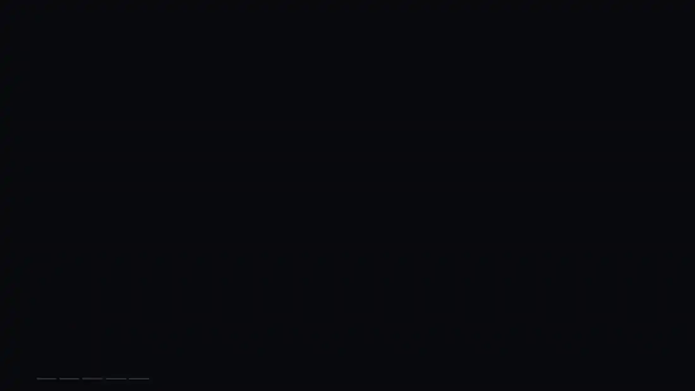

# KatArch

A video course on software architecture, built from what the twelve winners of O'Reilly's Architecture Katas left written: how an architecture is decided, and the territory of solutions that exist, with what each one gains and pays.

**[Watch the course](https://katarch.vercel.app)** · **[Case study](https://portfolio-felix-teal.vercel.app/work/katarch/)** · **Author: [Felix Andersson](https://portfolio-felix-teal.vercel.app)**

<a href="docs/reel/katarch-reel.mp4"></a>

<sub>[Full-quality MP4](docs/reel/katarch-reel.mp4) · [WebM](docs/reel/katarch-reel.webm)</sub>

## What it is

*The Architecture Map* (*El mapa de la arquitectura*): 17 narrated blocks, about 73 minutes, in Spanish and English. An opening with a whole system; a first act on how a decision is made (what makes it architectural, how it's written in an ADR, how qualities come out of a requirement and get checked with a number); a second act that walks the territory, one region of the map per block, each with a pair of real cases from the winning teams; and a closing.

Each block's page has its own player: sections, a synchronized transcript, captions drawn by the player (on, off, three styles, word by word), speed, keyboard control and saved progress. The site switches between Spanish and English next to the theme toggle. The videos are served from Cloudflare R2.

The course before this one, eleven lessons from the same material, keeps its routes (`/terreno/` and the old per-kata URLs send you home).

## How it's made

- **Scripts first.** Each block is written as prose, checked against the teams' repositories, then cut into scenes and lines (`cursos/curso-unico/guion-v2/`).
- **Animated in HTML.** Every block is a HyperFrames project (HTML and GSAP, seekable animations) whose scenes are anchored to words of the narration, never to fixed seconds.
- **Voice and timings.** The Spanish voice comes from ElevenLabs, one continuous take per scene; the cuts land in real silences. `scripts/build-curso-data.mjs` turns each block's narration and timings into `src/curso/bloques.json`: sections, transcript and word-level captions.

## Stack

- Astro 7 static site with React 19 islands, TypeScript, plain CSS with light and dark themes.
- **Hosting:** Vercel; the videos on Cloudflare R2.
- **Showreel:** a separate [Remotion](https://www.remotion.dev) project in `reel/`.

## Getting started

Needs Node 22.12 or later.

```bash
npm install
npm run dev                          # http://localhost:4321
npm run build                        # static site in dist/
node scripts/build-curso-data.mjs    # after re-rendering a block: sections, transcript, captions, posters
```

Deployment on Vercel is driven by `vercel.json`.

## Attribution

An independent teaching project built on public material from the competition. The original documents, diagrams and ADRs belong to the participating teams, published under [TheKataLog](https://github.com/TheKataLog).
