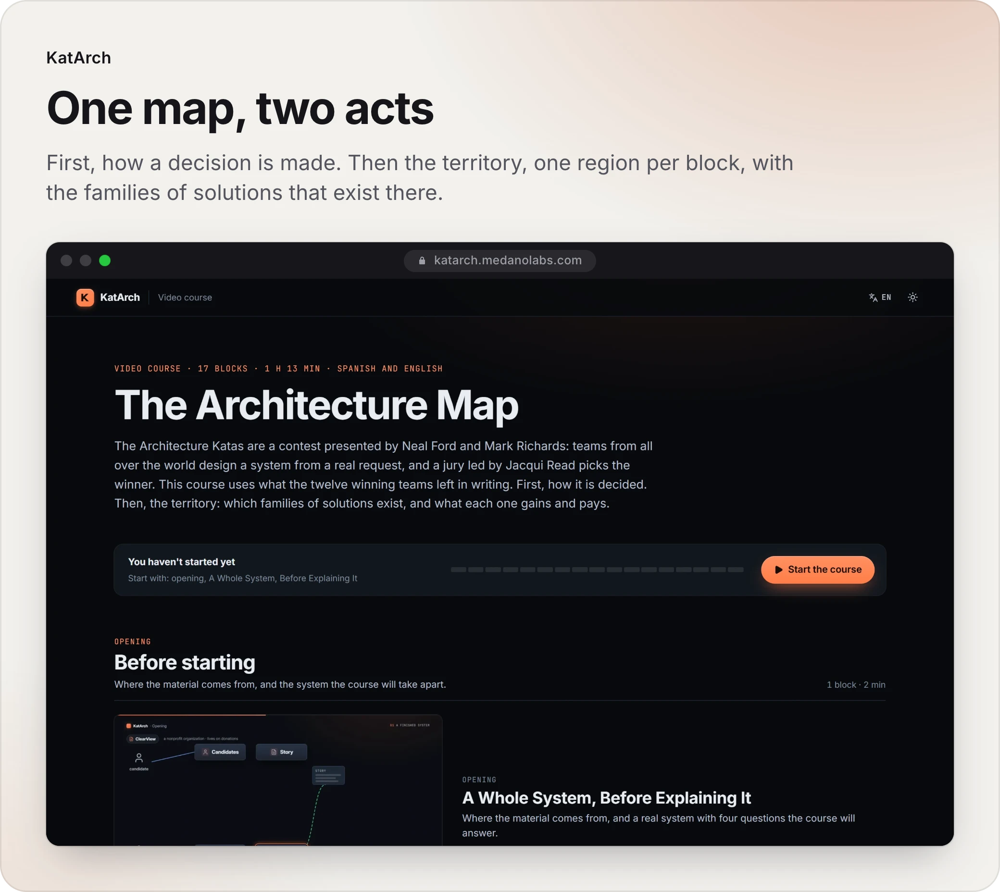
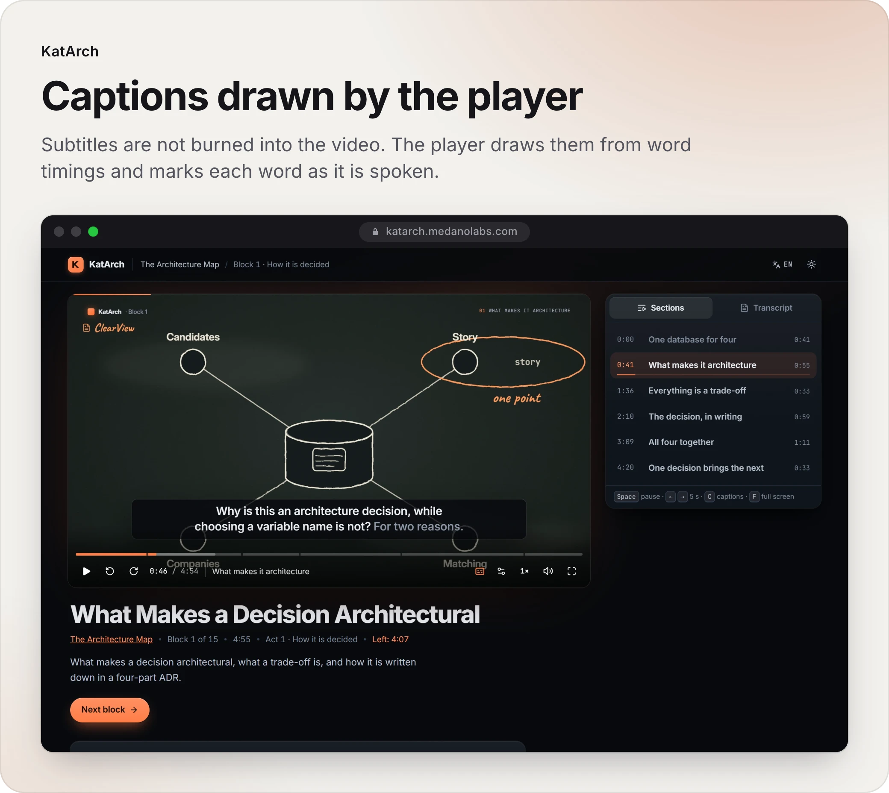
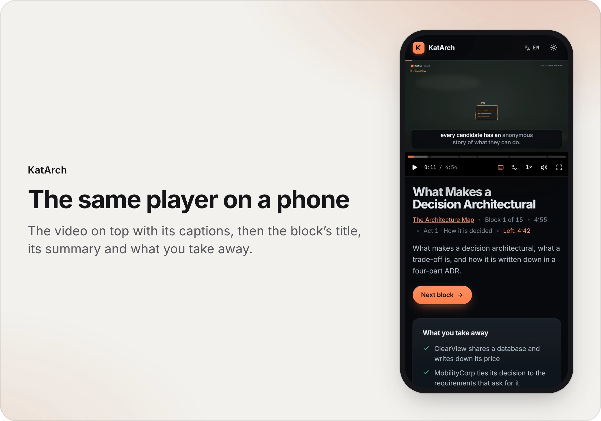

# KatArch

A narrated video course on software architecture, built from the written submissions of the twelve winners of O'Reilly's Architecture Katas. It covers how an architecture decision is made and the main families of solutions, with the trade-offs of each.

**[Watch the course](https://katarch.medanolabs.com)** · **[Case study](https://felix.medanolabs.com/work/katarch/)** · **Author: [Felix Andersson](https://felix.medanolabs.com)**

<picture>
  <source media="(prefers-color-scheme: dark)" srcset="docs/readme/01-course-dark.webp">
  
</picture>

<picture>
  <source media="(prefers-color-scheme: dark)" srcset="docs/readme/02-map-dark.webp">
  
</picture>

<picture>
  <source media="(prefers-color-scheme: dark)" srcset="docs/readme/03-captions-dark.webp">
  
</picture>

<picture>
  <source media="(prefers-color-scheme: dark)" srcset="docs/readme/04-phone-dark.webp">
  
</picture>

<sub>The course in 41 seconds, as a film: [MP4](docs/reel/katarch-reel.mp4) · [WebM](docs/reel/katarch-reel.webm)</sub>

## What it is

*The Architecture Map* (*El mapa de la arquitectura*): 17 narrated blocks, about 73 minutes, in Spanish and English.

- **Opening:** one whole system.
- **Act one:** how a decision is made: what makes it architectural, how it is recorded in an ADR, and how quality attributes are derived from a requirement and checked with a number.
- **Act two:** one region of the map per block, each with two real cases from the winning teams.
- **Closing.**

Each block has its own player with sections, a synchronized transcript, player-drawn captions (on/off, three styles, word-by-word highlighting), playback speed, keyboard control and saved progress. A switch next to the theme toggle changes the site between Spanish and English. Videos are served from Cloudflare R2.

The previous course, eleven lessons from the same material, keeps its routes (`/terreno/` and the old per-kata URLs redirect home).

## How it's made

- **Scripts first.** Each block is written as prose, checked against the teams' repositories, then cut into scenes and lines (`cursos/curso-unico/guion-v2/`).
- **Animated in HTML.** Each block is a HyperFrames project (HTML and GSAP, seekable animations). Scene animations are anchored to words in the narration, not to fixed times.
- **Voice and timings.** The Spanish voice is generated with ElevenLabs, one continuous take per scene, cut at real silences. `scripts/build-curso-data.mjs` turns each block's narration and timings into `src/curso/bloques.json`: sections, transcript and word-level captions.

## Stack

- Astro 7 static site with React 19 islands, TypeScript, plain CSS with light and dark themes.
- **Hosting:** Cloudflare Workers at katarch.medanolabs.com (`npm run deploy`); the videos on Cloudflare R2.
- **Showreel:** a separate [Remotion](https://www.remotion.dev) project in `reel/`.

## Getting started

Needs Node 22.12 or later.

```bash
npm install
npm run dev                          # http://localhost:4321
npm run build                        # static site in dist/
node scripts/build-curso-data.mjs    # after re-rendering a block: sections, transcript, captions, posters
```

The site is deployed as a Cloudflare Worker (`npm run deploy`, `wrangler.jsonc`).

## Attribution

An independent teaching project built on public material from the competition. The original documents, diagrams and ADRs belong to the participating teams, published under [TheKataLog](https://github.com/TheKataLog).
